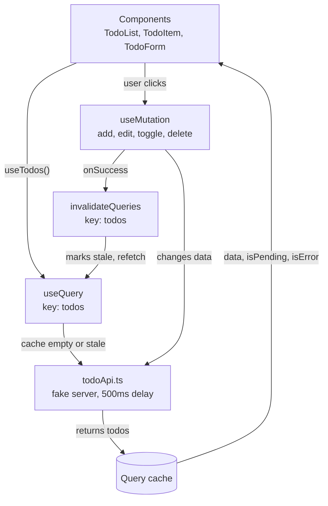
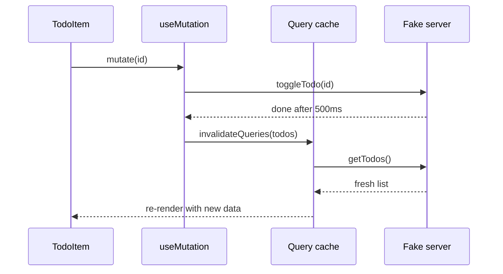
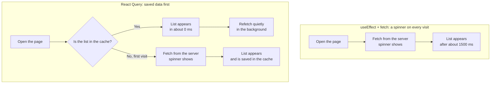
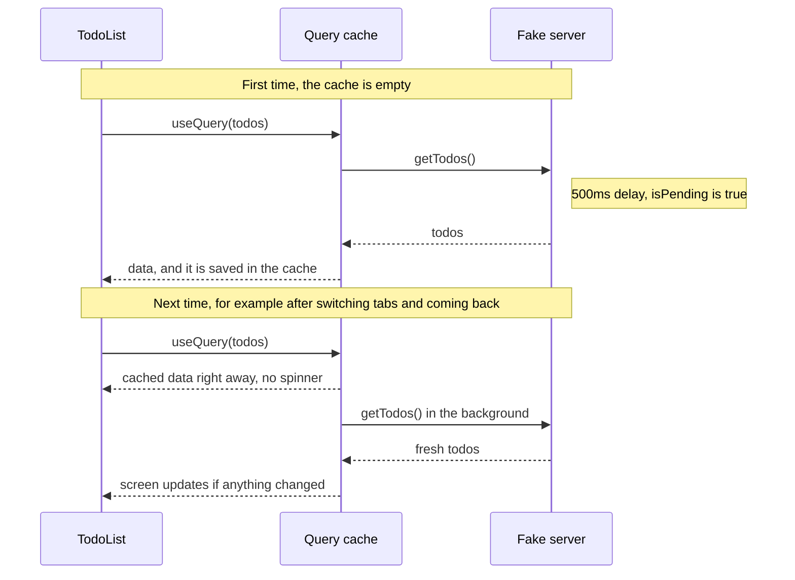
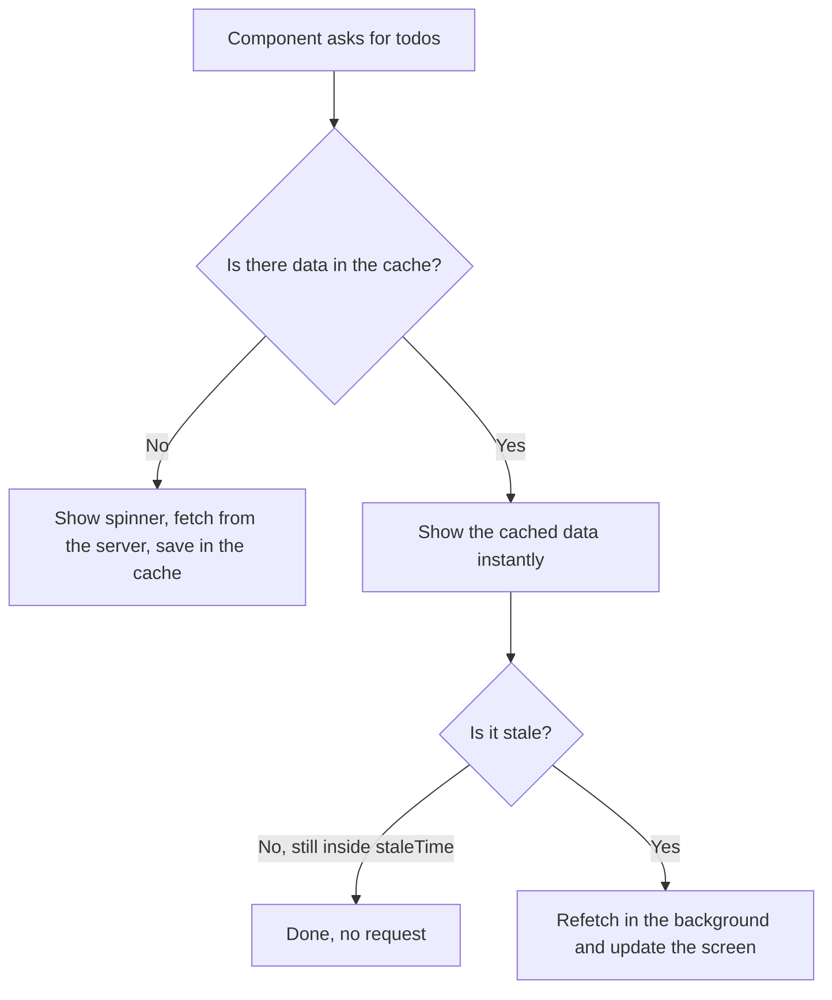

# Todo App with TanStack Query

A small todo app I built to learn TanStack Query (v5). It's not meant to be a product. It's a practice project where I tried to understand one idea properly: **how to deal with data that lives on a server**.

There's no real backend here. The "server" is just an array in memory with a 500ms delay on every call, so loading states are easy to see.

## What it does

- Shows a list of tasks
- Add a task
- Tick a task as done (or undo it)
- Edit a task's title
- Delete a task
- Shows a small badge with how many tasks are pending and how many are done
- Handles loading, error and empty states properly

## Tech used

| Tool | Why I used it |
|---|---|
| React + Vite | Fast to set up, quick reloads while learning |
| TypeScript | Catches silly mistakes early (like a typo in a field name) |
| Tailwind CSS v4 | Styling without writing a separate CSS file |
| TanStack Query v5 | Handles fetching, caching and refreshing server data |

## Hooks, components and TypeScript

### Custom hooks (`hooks/useTodos.ts`)

I wrapped every TanStack Query call in its own hook: `useTodos`, `useAddTodo`, `useToggleTodo`, `useEditTodo` and `useDeleteTodo`. Components just call a hook and get data back, without knowing how it was fetched. If the API changes later, I only fix one file. I also used React's own `useState` in the add form to hold what the user is typing.

### Components (`components/`)

Each component does one small job. `TodoList` decides what to show (spinner, error, empty or list), `TodoItem` handles a single row with its checkbox and delete button, `TodoForm` is the input, and `TodoCount` is the badges. Keeping them small makes it easy to find where something is broken.

### TypeScript (`types/todo.ts`)

I defined one `Todo` interface and reused it everywhere: as the return type of the API functions (`Promise<Todo[]>`), as the props of `TodoItem` and `TodoCount`, and indirectly through `useQuery`, which knows `data` is a list of todos. This gives me autocomplete and TypeScript warns me if I use a field that doesn't exist.

## How it works

These diagrams are written in Mermaid, so GitHub draws them for you and they resize to fit the screen.

### The big picture

Reading goes through `useQuery`. Changing goes through `useMutation`, and after every change `invalidateQueries` sends us back to reading so the list stays fresh.



### What happens when you tick a checkbox



### useEffect vs React Query

With a plain `useEffect` and `fetch`, the user waits for the server on every visit. With React Query, the saved list shows first and the fresh copy arrives quietly afterwards.



### How the cache works

The first time `TodoList` asks for the todos, the cache is empty, so TanStack Query goes to the server and you see the spinner. After that the list is saved in the cache. The next time something asks for `['todos']`, the saved list is shown right away, with no spinner, and a fresh copy is fetched quietly in the background.



And this is how TanStack Query decides what to do each time:



A few things worth knowing:

- **Stale** means "might be out of date". In TanStack Query v5, `staleTime` defaults to `0`, so data counts as stale straight away and is refetched on mount, on window focus and on reconnect.
- **Try it:** open the app, switch to another browser tab and come back. The list stays on screen and "Syncing…" flashes for a moment. That is the background refetch.
- **`gcTime`** (default 5 minutes) is how long unused data stays in the cache before it is thrown away.
- **The cache lives in memory.** It survives components mounting and unmounting, but a full browser refresh empties it, so the next load shows the spinner again.

## The concepts, and why they're here

### 1. The `Todo` type

```ts
interface Todo {
  id: string;
  title: string;
  completed: boolean;
}
```

Every todo has exactly these three fields. If I misspell `completed` somewhere, TypeScript shouts at me before the app even runs.

### 2. `QueryClient` and `QueryClientProvider` (in `main.tsx`)

The `QueryClient` is the cache. It's where TanStack Query remembers everything it has fetched. The provider wraps the app so every component can reach that cache.

Without the provider, `useQuery` has nowhere to store anything and React throws an error.

### 3. `useQuery`: reading data

```ts
useQuery({ queryKey: ['todos'], queryFn: getTodos })
```

- **`queryFn`** is the function that actually gets the data.
- **`queryKey`** is the name of that data in the cache.

`useQuery` gives back things like `data`, `isPending`, `isError` and `error`, so I don't have to write `useState` and `useEffect` for loading and errors myself. This was the biggest win for me. Doing it by hand takes a lot more code and is easy to get wrong.

### 4. Query keys

`['todos']` is just a label, but it matters. Two things happen because of it:

1. If two components ask for `['todos']`, they share one cache entry instead of fetching twice.
2. Later I can say "refresh `['todos']`" and TanStack Query knows exactly what I mean.

### 5. `useMutation`: changing data

`useQuery` is for reading. Anything that changes data (add, edit, toggle, delete) uses `useMutation`.

I have four of them: `useAddTodo`, `useToggleTodo`, `useEditTodo` and `useDeleteTodo`. Each one gives me `mutate()` to trigger it and `isPending` to know it's still running. I use `isPending` to disable the button and dim the row so nobody double-clicks.

### 6. `invalidateQueries`: keeping the list fresh

This is the part I'd tell a beginner to focus on.

After a mutation succeeds, the list on screen is out of date. The server changed, but my cached copy didn't. So in `onSuccess` I call:

```ts
queryClient.invalidateQueries({ queryKey: ['todos'] })
```

That marks the cached list as stale and TanStack Query refetches it. The UI updates on its own. I never have to manually edit the list in state.

### 7. `isPending`, `isError` and the empty state

`TodoList.tsx` checks these in order:

1. `isPending`: no data yet, so show a spinner
2. `isError`: the request failed, so show the message and a "Try again" button
3. `data.length === 0`: it worked, but there's nothing to show
4. Otherwise render the list

I also use `isFetching` to show a small "Syncing…" text. It's `true` whenever a refetch is running in the background, even when there's already data on screen. `isPending` only covers the very first load.

## Resources

- [TanStack Query docs](https://tanstack.com/query/latest)
- [Chai aur Typescript](https://www.youtube.com/playlist?list=PLu71SKxNbfoBkkr8lblqtsJvxrw3j1tWC) playlist, which helped me with the TypeScript side
